<!-- GENERATED by `npm run docs:generate` from src/database/schema/*.ts and policies/spec.ts. Do not edit by hand. -->

# Entity-relationship diagrams

## Platform overview (hand-curated)

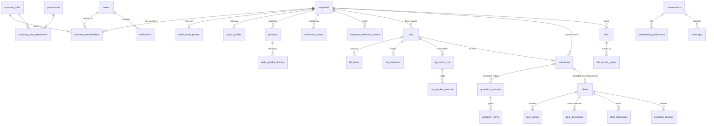

Relationship notation: `parent ||--o{ child : "fk column(s)"`. Composite tenant foreign keys appear as `child_id+company_id`.

## A. Global reference data

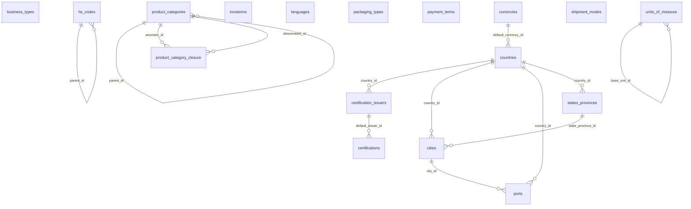

## B. Identity and authentication

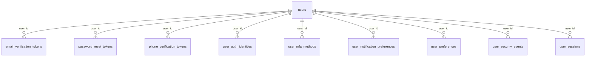

## C. Companies, membership and RBAC

```mermaid
erDiagram
  companies {
  }
  company_addresses {
  }
  company_business_types {
  }
  company_contacts {
  }
  company_invitations {
  }
  company_memberships {
  }
  company_profiles {
  }
  company_registration_identifiers {
  }
  company_role_permissions {
  }
  company_roles {
  }
  company_settings {
  }
  permissions {
  }
  countries {
  }
  users {
  }
  cities {
  }
  states_provinces {
  }
  business_types {
  }
  currencies {
  }
  languages {
  }
  countries ||--o{ companies : "country_id"
  users ||--o{ companies : "created_by_user_id"
  companies ||--o{ company_addresses : "company_id"
  cities ||--o{ company_addresses : "city_id"
  states_provinces ||--o{ company_addresses : "state_province_id"
  countries ||--o{ company_addresses : "country_id"
  companies ||--o{ company_business_types : "company_id"
  business_types ||--o{ company_business_types : "business_type_id"
  companies ||--o{ company_contacts : "company_id"
  users ||--o{ company_contacts : "user_id"
  companies ||--o{ company_invitations : "company_id"
  company_roles ||--o{ company_invitations : "role_id"
  users ||--o{ company_invitations : "invited_by_user_id"
  users ||--o{ company_invitations : "accepted_by_user_id"
  companies ||--o{ company_memberships : "company_id"
  users ||--o{ company_memberships : "user_id"
  company_roles ||--o{ company_memberships : "role_id"
  users ||--o{ company_memberships : "invited_by_user_id"
  users ||--o{ company_memberships : "removed_by_user_id"
  companies ||--o{ company_profiles : "company_id"
  companies ||--o{ company_registration_identifiers : "company_id"
  countries ||--o{ company_registration_identifiers : "country_id"
  company_roles ||--o{ company_role_permissions : "role_id"
  permissions ||--o{ company_role_permissions : "permission_id"
  companies ||--o{ company_roles : "company_id"
  companies ||--o{ company_settings : "company_id"
  currencies ||--o{ company_settings : "default_currency_id"
  languages ||--o{ company_settings : "default_language_id"
```

## D. Files and documents

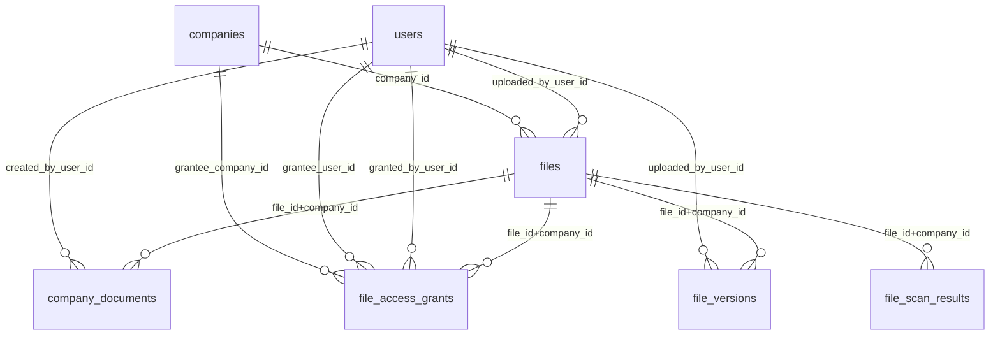

## E. Verification and compliance

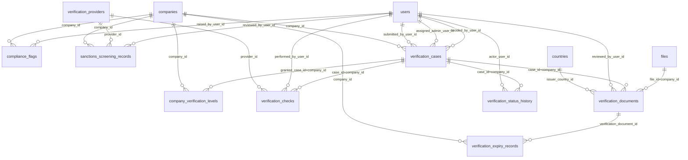

## F. Product catalog

```mermaid
erDiagram
  product_categories_mapping {
  }
  product_certifications {
  }
  product_documents {
  }
  product_hs_codes {
  }
  product_images {
  }
  product_specification_definitions {
  }
  product_specifications {
  }
  products {
  }
  seller_product_listings {
  }
  product_categories {
  }
  certifications {
  }
  certification_issuers {
  }
  files {
  }
  hs_codes {
  }
  units_of_measure {
  }
  companies {
  }
  countries {
  }
  currencies {
  }
  incoterms {
  }
  ports {
  }
  product_categories ||--o{ product_categories_mapping : "category_id"
  products ||--o{ product_categories_mapping : "product_id+company_id"
  certifications ||--o{ product_certifications : "certification_id"
  certification_issuers ||--o{ product_certifications : "issuer_id"
  products ||--o{ product_certifications : "product_id+company_id"
  files ||--o{ product_certifications : "file_id+company_id"
  products ||--o{ product_documents : "product_id+company_id"
  files ||--o{ product_documents : "file_id+company_id"
  hs_codes ||--o{ product_hs_codes : "hs_code_id"
  products ||--o{ product_hs_codes : "product_id+company_id"
  products ||--o{ product_images : "product_id+company_id"
  files ||--o{ product_images : "file_id+company_id"
  product_categories ||--o{ product_specification_definitions : "category_id"
  units_of_measure ||--o{ product_specification_definitions : "uom_id"
  product_specification_definitions ||--o{ product_specifications : "definition_id"
  units_of_measure ||--o{ product_specifications : "uom_id"
  products ||--o{ product_specifications : "product_id+company_id"
  companies ||--o{ products : "company_id"
  companies ||--o{ products : "manufacturer_company_id"
  countries ||--o{ products : "origin_country_id"
  product_categories ||--o{ products : "primary_category_id"
  units_of_measure ||--o{ products : "base_uom_id"
  units_of_measure ||--o{ seller_product_listings : "moq_uom_id"
  currencies ||--o{ seller_product_listings : "currency_id"
  units_of_measure ||--o{ seller_product_listings : "capacity_uom_id"
  incoterms ||--o{ seller_product_listings : "incoterm_id"
  ports ||--o{ seller_product_listings : "origin_port_id"
  products ||--o{ seller_product_listings : "product_id+company_id"
```

## G. Seller trade profile and buyer profile

```mermaid
erDiagram
  buyer_import_markets {
  }
  buyer_import_requirements {
  }
  buyer_preferred_origins {
  }
  buyer_product_interests {
  }
  buyer_profiles {
  }
  buyer_trade_preferences {
  }
  seller_accepted_currencies {
  }
  seller_capabilities {
  }
  seller_capacity_records {
  }
  seller_certifications {
  }
  seller_export_markets {
  }
  seller_incoterm_capabilities {
  }
  seller_lead_times {
  }
  seller_moq_records {
  }
  seller_packaging_capabilities {
  }
  seller_payment_methods {
  }
  seller_product_capabilities {
  }
  seller_shipping_ports {
  }
  seller_supply_regions {
  }
  seller_trade_profiles {
  }
  seller_trade_terms {
  }
  companies {
  }
  countries {
  }
  certifications {
  }
  product_categories {
  }
  hs_codes {
  }
  currencies {
  }
  incoterms {
  }
  payment_terms {
  }
  shipment_modes {
  }
  units_of_measure {
  }
  products {
  }
  certification_issuers {
  }
  files {
  }
  ports {
  }
  packaging_types {
  }
  states_provinces {
  }
  companies ||--o{ buyer_import_markets : "company_id"
  countries ||--o{ buyer_import_markets : "country_id"
  companies ||--o{ buyer_import_requirements : "company_id"
  certifications ||--o{ buyer_import_requirements : "certification_id"
  companies ||--o{ buyer_preferred_origins : "company_id"
  countries ||--o{ buyer_preferred_origins : "country_id"
  companies ||--o{ buyer_product_interests : "company_id"
  product_categories ||--o{ buyer_product_interests : "category_id"
  hs_codes ||--o{ buyer_product_interests : "hs_code_id"
  companies ||--o{ buyer_profiles : "company_id"
  companies ||--o{ buyer_trade_preferences : "company_id"
  currencies ||--o{ buyer_trade_preferences : "preferred_currency_id"
  incoterms ||--o{ buyer_trade_preferences : "preferred_incoterm_id"
  payment_terms ||--o{ buyer_trade_preferences : "preferred_payment_term_id"
  shipment_modes ||--o{ buyer_trade_preferences : "preferred_shipment_mode_id"
  companies ||--o{ seller_accepted_currencies : "company_id"
  currencies ||--o{ seller_accepted_currencies : "currency_id"
  companies ||--o{ seller_capabilities : "company_id"
  companies ||--o{ seller_capacity_records : "company_id"
  product_categories ||--o{ seller_capacity_records : "category_id"
  units_of_measure ||--o{ seller_capacity_records : "uom_id"
  products ||--o{ seller_capacity_records : "product_id+company_id"
  companies ||--o{ seller_certifications : "company_id"
  certifications ||--o{ seller_certifications : "certification_id"
  certification_issuers ||--o{ seller_certifications : "issuer_id"
  files ||--o{ seller_certifications : "file_id+company_id"
  companies ||--o{ seller_export_markets : "company_id"
  countries ||--o{ seller_export_markets : "country_id"
  companies ||--o{ seller_incoterm_capabilities : "company_id"
  incoterms ||--o{ seller_incoterm_capabilities : "incoterm_id"
  ports ||--o{ seller_incoterm_capabilities : "port_id"
  shipment_modes ||--o{ seller_incoterm_capabilities : "shipment_mode_id"
  companies ||--o{ seller_lead_times : "company_id"
  product_categories ||--o{ seller_lead_times : "category_id"
  products ||--o{ seller_lead_times : "product_id+company_id"
  companies ||--o{ seller_moq_records : "company_id"
  product_categories ||--o{ seller_moq_records : "category_id"
  units_of_measure ||--o{ seller_moq_records : "uom_id"
  currencies ||--o{ seller_moq_records : "currency_id"
  products ||--o{ seller_moq_records : "product_id+company_id"
  companies ||--o{ seller_packaging_capabilities : "company_id"
  packaging_types ||--o{ seller_packaging_capabilities : "packaging_type_id"
  companies ||--o{ seller_payment_methods : "company_id"
  payment_terms ||--o{ seller_payment_methods : "payment_term_id"
  companies ||--o{ seller_product_capabilities : "company_id"
  product_categories ||--o{ seller_product_capabilities : "category_id"
  hs_codes ||--o{ seller_product_capabilities : "hs_code_id"
  products ||--o{ seller_product_capabilities : "product_id+company_id"
  companies ||--o{ seller_shipping_ports : "company_id"
  ports ||--o{ seller_shipping_ports : "port_id"
  companies ||--o{ seller_supply_regions : "company_id"
  countries ||--o{ seller_supply_regions : "country_id"
  states_provinces ||--o{ seller_supply_regions : "state_province_id"
  companies ||--o{ seller_trade_profiles : "company_id"
  companies ||--o{ seller_trade_terms : "company_id"
  currencies ||--o{ seller_trade_terms : "min_order_currency_id"
```

## H. RFQ management

```mermaid
erDiagram
  rfq_attachments {
  }
  rfq_certification_requirements {
  }
  rfq_clarifications {
  }
  rfq_destinations {
  }
  rfq_invitations {
  }
  rfq_items {
  }
  rfq_origin_preferences {
  }
  rfq_payment_preferences {
  }
  rfq_required_documents {
  }
  rfq_saved_records {
  }
  rfq_specifications {
  }
  rfq_status_history {
  }
  rfq_trade_requirements {
  }
  rfq_views {
  }
  rfq_visibility_rules {
  }
  rfqs {
  }
  files {
  }
  certifications {
  }
  companies {
  }
  users {
  }
  countries {
  }
  ports {
  }
  incoterms {
  }
  product_categories {
  }
  hs_codes {
  }
  units_of_measure {
  }
  payment_terms {
  }
  product_specification_definitions {
  }
  packaging_types {
  }
  shipment_modes {
  }
  currencies {
  }
  rfqs ||--o{ rfq_attachments : "rfq_id+company_id"
  files ||--o{ rfq_attachments : "file_id+company_id"
  certifications ||--o{ rfq_certification_requirements : "certification_id"
  rfqs ||--o{ rfq_certification_requirements : "rfq_id+company_id"
  rfq_items ||--o{ rfq_certification_requirements : "rfq_item_id+company_id"
  companies ||--o{ rfq_clarifications : "asked_by_company_id"
  users ||--o{ rfq_clarifications : "asked_by_user_id"
  users ||--o{ rfq_clarifications : "answered_by_user_id"
  rfqs ||--o{ rfq_clarifications : "rfq_id+rfq_company_id"
  countries ||--o{ rfq_destinations : "country_id"
  ports ||--o{ rfq_destinations : "port_id"
  incoterms ||--o{ rfq_destinations : "incoterm_id"
  rfqs ||--o{ rfq_destinations : "rfq_id+company_id"
  companies ||--o{ rfq_invitations : "invited_company_id"
  users ||--o{ rfq_invitations : "invited_by_user_id"
  rfqs ||--o{ rfq_invitations : "rfq_id+company_id"
  product_categories ||--o{ rfq_items : "category_id"
  hs_codes ||--o{ rfq_items : "hs_code_id"
  units_of_measure ||--o{ rfq_items : "uom_id"
  rfqs ||--o{ rfq_items : "rfq_id+company_id"
  countries ||--o{ rfq_origin_preferences : "country_id"
  rfqs ||--o{ rfq_origin_preferences : "rfq_id+company_id"
  payment_terms ||--o{ rfq_payment_preferences : "payment_term_id"
  rfqs ||--o{ rfq_payment_preferences : "rfq_id+company_id"
  rfqs ||--o{ rfq_required_documents : "rfq_id+company_id"
  rfqs ||--o{ rfq_saved_records : "rfq_id"
  companies ||--o{ rfq_saved_records : "company_id"
  users ||--o{ rfq_saved_records : "user_id"
  product_specification_definitions ||--o{ rfq_specifications : "definition_id"
  units_of_measure ||--o{ rfq_specifications : "uom_id"
  rfq_items ||--o{ rfq_specifications : "rfq_item_id+company_id"
  users ||--o{ rfq_status_history : "actor_user_id"
  rfqs ||--o{ rfq_status_history : "rfq_id+company_id"
  packaging_types ||--o{ rfq_trade_requirements : "packaging_type_id"
  shipment_modes ||--o{ rfq_trade_requirements : "shipment_mode_id"
  rfqs ||--o{ rfq_trade_requirements : "rfq_id+company_id"
  rfqs ||--o{ rfq_views : "rfq_id"
  companies ||--o{ rfq_views : "company_id"
  users ||--o{ rfq_views : "viewer_user_id"
  countries ||--o{ rfq_visibility_rules : "country_id"
  rfqs ||--o{ rfq_visibility_rules : "rfq_id+company_id"
  companies ||--o{ rfqs : "company_id"
  users ||--o{ rfqs : "created_by_user_id"
  product_categories ||--o{ rfqs : "primary_category_id"
  currencies ||--o{ rfqs : "currency_id"
```

## I. Supplier matching

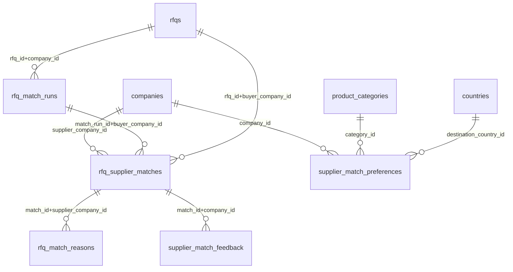

## J. Quotations and negotiation

```mermaid
erDiagram
  negotiation_events {
  }
  quotation_attachments {
  }
  quotation_certifications {
  }
  quotation_comparison_entries {
  }
  quotation_comparisons {
  }
  quotation_items {
  }
  quotation_revisions {
  }
  quotation_specifications {
  }
  quotation_status_history {
  }
  quotation_terms {
  }
  quotations {
  }
  companies {
  }
  users {
  }
  files {
  }
  certifications {
  }
  rfqs {
  }
  rfq_items {
  }
  units_of_measure {
  }
  hs_codes {
  }
  countries {
  }
  currencies {
  }
  product_specification_definitions {
  }
  incoterms {
  }
  ports {
  }
  payment_terms {
  }
  packaging_types {
  }
  shipment_modes {
  }
  companies ||--o{ negotiation_events : "actor_company_id"
  users ||--o{ negotiation_events : "actor_user_id"
  quotations ||--o{ negotiation_events : "quotation_id+company_id"
  quotation_revisions ||--o{ quotation_attachments : "revision_id+company_id"
  files ||--o{ quotation_attachments : "file_id+company_id"
  certifications ||--o{ quotation_certifications : "certification_id"
  quotation_revisions ||--o{ quotation_certifications : "revision_id+company_id"
  files ||--o{ quotation_certifications : "file_id+company_id"
  quotations ||--o{ quotation_comparison_entries : "quotation_id"
  quotation_revisions ||--o{ quotation_comparison_entries : "revision_id"
  quotation_comparisons ||--o{ quotation_comparison_entries : "comparison_id+company_id"
  users ||--o{ quotation_comparisons : "created_by_user_id"
  rfqs ||--o{ quotation_comparisons : "rfq_id+company_id"
  rfq_items ||--o{ quotation_items : "rfq_item_id"
  units_of_measure ||--o{ quotation_items : "uom_id"
  hs_codes ||--o{ quotation_items : "hs_code_id"
  countries ||--o{ quotation_items : "origin_country_id"
  quotation_revisions ||--o{ quotation_items : "revision_id+company_id"
  currencies ||--o{ quotation_revisions : "currency_id"
  users ||--o{ quotation_revisions : "created_by_user_id"
  quotations ||--o{ quotation_revisions : "quotation_id+company_id"
  product_specification_definitions ||--o{ quotation_specifications : "definition_id"
  units_of_measure ||--o{ quotation_specifications : "uom_id"
  quotation_items ||--o{ quotation_specifications : "quotation_item_id+company_id"
  companies ||--o{ quotation_status_history : "actor_company_id"
  users ||--o{ quotation_status_history : "actor_user_id"
  quotations ||--o{ quotation_status_history : "quotation_id+company_id"
  incoterms ||--o{ quotation_terms : "incoterm_id"
  ports ||--o{ quotation_terms : "port_of_loading_id"
  payment_terms ||--o{ quotation_terms : "payment_term_id"
  packaging_types ||--o{ quotation_terms : "packaging_type_id"
  shipment_modes ||--o{ quotation_terms : "shipment_mode_id"
  quotation_revisions ||--o{ quotation_terms : "revision_id+company_id"
  companies ||--o{ quotations : "company_id"
  users ||--o{ quotations : "created_by_user_id"
  currencies ||--o{ quotations : "currency_id"
  rfqs ||--o{ quotations : "rfq_id+buyer_company_id"
```

## K. Deals and deal room

```mermaid
erDiagram
  deal_activity_events {
  }
  deal_cancellations {
  }
  deal_confirmations {
  }
  deal_disputes {
  }
  deal_document_versions {
  }
  deal_documents {
  }
  deal_items {
  }
  deal_milestone_events {
  }
  deal_milestones {
  }
  deal_parties {
  }
  deal_shipments {
  }
  deal_status_history {
  }
  deal_terms {
  }
  deals {
  }
  companies {
  }
  users {
  }
  files {
  }
  rfq_items {
  }
  units_of_measure {
  }
  hs_codes {
  }
  countries {
  }
  ports {
  }
  incoterms {
  }
  payment_terms {
  }
  packaging_types {
  }
  shipment_modes {
  }
  rfqs {
  }
  currencies {
  }
  quotations {
  }
  quotation_revisions {
  }
  deals ||--o{ deal_activity_events : "deal_id"
  companies ||--o{ deal_activity_events : "actor_company_id"
  users ||--o{ deal_activity_events : "actor_user_id"
  deals ||--o{ deal_cancellations : "deal_id"
  companies ||--o{ deal_cancellations : "requested_by_company_id"
  users ||--o{ deal_cancellations : "requested_by_user_id"
  companies ||--o{ deal_cancellations : "responded_by_company_id"
  deals ||--o{ deal_confirmations : "deal_id"
  companies ||--o{ deal_confirmations : "company_id"
  users ||--o{ deal_confirmations : "confirmed_by_user_id"
  deals ||--o{ deal_disputes : "deal_id"
  companies ||--o{ deal_disputes : "raised_by_company_id"
  users ||--o{ deal_disputes : "raised_by_user_id"
  companies ||--o{ deal_document_versions : "uploaded_by_company_id"
  users ||--o{ deal_document_versions : "uploaded_by_user_id"
  files ||--o{ deal_document_versions : "file_id+uploaded_by_company_id"
  deal_documents ||--o{ deal_document_versions : "document_id+deal_id"
  deals ||--o{ deal_documents : "deal_id"
  companies ||--o{ deal_documents : "created_by_company_id"
  users ||--o{ deal_documents : "created_by_user_id"
  deals ||--o{ deal_items : "deal_id"
  rfq_items ||--o{ deal_items : "rfq_item_id"
  units_of_measure ||--o{ deal_items : "uom_id"
  hs_codes ||--o{ deal_items : "hs_code_id"
  countries ||--o{ deal_items : "origin_country_id"
  companies ||--o{ deal_milestone_events : "actor_company_id"
  users ||--o{ deal_milestone_events : "actor_user_id"
  deal_milestones ||--o{ deal_milestone_events : "milestone_id+deal_id"
  deals ||--o{ deal_milestones : "deal_id"
  companies ||--o{ deal_milestones : "responsible_company_id"
  deals ||--o{ deal_parties : "deal_id"
  companies ||--o{ deal_parties : "company_id"
  users ||--o{ deal_parties : "added_by_user_id"
  deals ||--o{ deal_shipments : "deal_id"
  ports ||--o{ deal_shipments : "port_of_loading_id"
  ports ||--o{ deal_shipments : "port_of_discharge_id"
  companies ||--o{ deal_shipments : "added_by_company_id"
  deals ||--o{ deal_status_history : "deal_id"
  companies ||--o{ deal_status_history : "actor_company_id"
  users ||--o{ deal_status_history : "actor_user_id"
  deals ||--o{ deal_terms : "deal_id"
  incoterms ||--o{ deal_terms : "incoterm_id"
  ports ||--o{ deal_terms : "port_of_loading_id"
  payment_terms ||--o{ deal_terms : "payment_term_id"
  packaging_types ||--o{ deal_terms : "packaging_type_id"
  shipment_modes ||--o{ deal_terms : "shipment_mode_id"
  rfqs ||--o{ deals : "rfq_id"
  currencies ||--o{ deals : "currency_id"
  quotations ||--o{ deals : "quotation_id+supplier_company_id"
  quotations ||--o{ deals : "quotation_id+buyer_company_id"
  quotation_revisions ||--o{ deals : "accepted_revision_id+quotation_id"
  companies ||--o{ deals : "buyer_company_id"
  companies ||--o{ deals : "supplier_company_id"
```

## L. Conversations and messaging

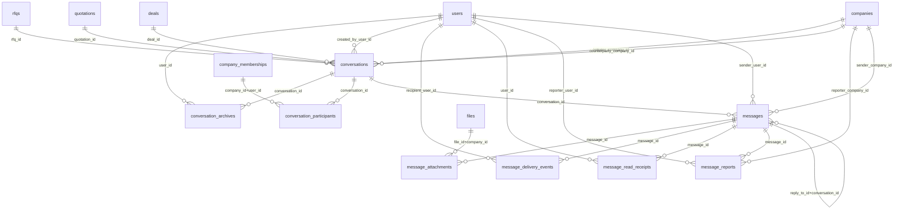

## M. Reviews and reputation

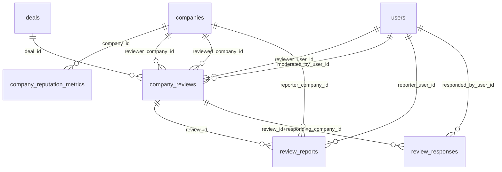

## N. Notifications

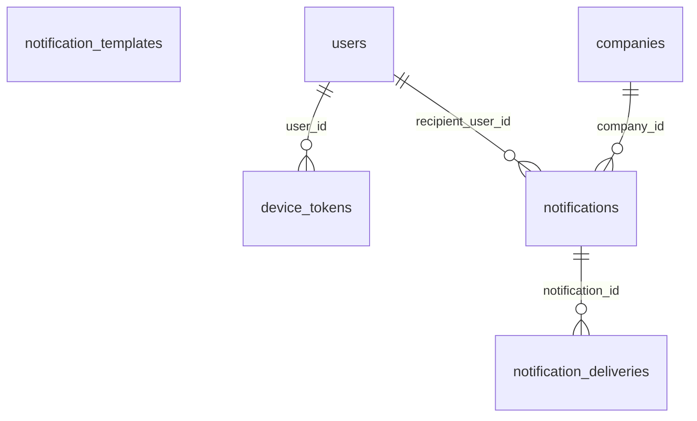

## O. Administration, audit, outbox

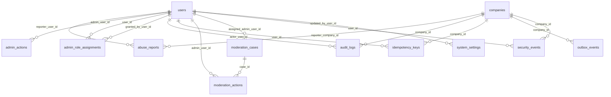
