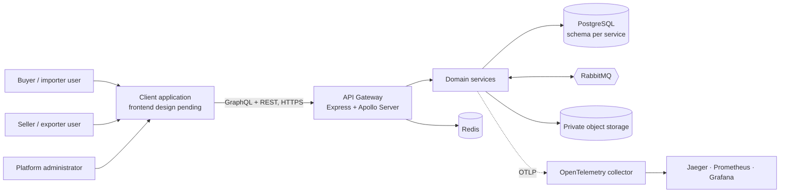
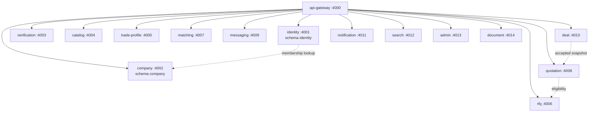

# System Architecture

Status: design document. The backend foundation, authentication and company services are implemented; everything else described here is planned.

## 1. Context



## 2. Containers and ownership



Solid arrows: client-facing calls from the gateway. Dotted: internal service-token calls (the only allowed service→service synchronous calls). Everything else is asynchronous events.

## 3. Request flow (GraphQL)

```mermaid
sequenceDiagram
  participant C as Client
  participant G as Gateway
  participant R as Redis
  participant S as Service
  participant P as PostgreSQL
  C->>G: POST /graphql (persisted query id, JWT)
  G->>G: verify JWT (JWKS), depth/complexity, body size
  G->>R: rate-limit check (key: user+company)
  G->>S: internal REST + service token + user claims (DataLoader-batched)
  S->>P: BEGIN; set_config(user, company, local); projected SELECT; COMMIT
  S-->>G: DTO
  G-->>C: only the requested fields + request id
```

Tenant id is **never** taken from the client: it comes from the signed token claim for the *active company* chosen at token issue (Identity asks Company Service to confirm membership).

## 4. Authentication and authorization

* **Access token**: short-lived (≤5 min) JWT signed with an asymmetric key (EdDSA), claims `sub` (user), `cid` (active company), `roles`/`perms` (company-scoped), `sid` (session), `ver` (session version). Verified at the gateway **and** re-verified by each service (JWKS published by Identity).
* **Refresh token**: opaque, rotated on every use, stored hashed with a family id; reuse of a rotated token revokes the family. Session revocation bumps `ver`; gateway keeps a Redis denylist keyed by `sid` until token expiry.
* **MFA**: TOTP/WebAuthn enrolment in Identity; step-up claims (`amr`) required for admin and sensitive mutations.
* **Authorization layers**: (1) gateway field guards from claims; (2) service use-case permission checks; (3) PostgreSQL RLS by `company_id` with transaction-local context; (4) resource relationships (e.g. quotation visible to supplier and, once non-draft, to the RFQ buyer).
* **Service-to-service**: short-lived service JWT (`iss` = calling service, `aud` = target) plus forwarded user claims; mTLS in production environments.

## 5. Event-driven architecture

```mermaid
flowchart LR
  subgraph Producer service
    TX[(business tx + outbox row)] --> relay[outbox relay]
  end
  relay --> ex{{RabbitMQ topic exchange<br/>saudaro.events}}
  ex --> q1[queue per consumer<br/>quorum, DLX]
  q1 --> cons[idempotent consumer<br/>inbox table]
  q1 -. retries exp. backoff + jitter .-> dlq[(dead-letter queue)]
```

* **Envelope** (all events): `eventId`, `type`, `schemaVersion`, `occurredAt`, `producer`, `correlationId`, `causationId`, minimal `payload`.
* **Producers / consumers** (planned):

| Event | Producer | Consumers |
|---|---|---|
| `user.registered.v1` | identity | notification, admin |
| `company.created.v1` | company | verification, trade-profile, search, admin |
| `company.verified.v1` | verification | company, search, rfq, matching, notification |
| `product.published.v1` | catalog | search, matching |
| `rfq.published.v1` | rfq | matching, search, notification |
| `supplier.match.created.v1` | matching | notification, rfq |
| `quotation.submitted.v1` | quotation | notification, rfq |
| `quotation.accepted.v1` | quotation | rfq (award), deal (create), notification |
| `deal.created.v1` | deal | messaging, notification, search |
| `message.created.v1` | messaging | notification, gateway (subscriptions) |
| `deal.completed.v1` | deal | notification, company (reputation) |

* **Delivery semantics**: at-least-once + idempotent consumers (`inbox_events` unique on `(consumer, event_id)`); publisher confirms; per-service outbox relay polls with `FOR UPDATE SKIP LOCKED`.

## 6. Saga: accepting a quotation

```mermaid
sequenceDiagram
  participant B as Buyer
  participant Q as Quotation svc
  participant R as RFQ svc
  participant D as Deal svc
  B->>Q: acceptQuotation(id, revision)
  Q->>Q: tx: lock quotation row, unique "one accepted per rfq", status=accepted, outbox quotation.accepted.v1
  Q-->>B: accepted (terms now immutable)
  Q-)R: quotation.accepted.v1
  R->>R: award RFQ, close to new quotes (idempotent)
  Q-)D: quotation.accepted.v1 (revision id + content hash)
  D->>Q: GET /internal/quotations/{id}/revisions/{rev}
  D->>D: verify hash, store immutable snapshot, create deal + parties, outbox deal.created.v1
  Note over Q,D: if Deal cannot be created (hash mismatch / repeated failure) → DLQ + saga record "needs attention"; the quotation stays accepted (never silently reverted); operators resolve via event-worker
```

Race safety lives where the data lives: *one accepted quotation per RFQ* is a unique index inside Quotation Service. No cross-service transaction is used.

## 7. Data architecture

* One PostgreSQL cluster, **one schema and one login role per service**; roles are `NOSUPERUSER NOBYPASSRLS`; `REVOKE` on all other schemas; migrations run by a per-service migrator role; app role owns nothing.
* RLS on tenant tables by `company_id` from the transaction-local context (design carried over from the existing foundation, including column-level grants and append-only audit triggers).
* Reference data is read-only in every schema that needs it, seeded from `packages/reference-data`.
* Search: Search Service owns denormalised documents (PostgreSQL FTS + `pg_trgm`); `pgvector` is **not** introduced until a semantic-search requirement is approved.
* Detail: `backend/docs/DATABASE_DESIGN.md`, `INDEXING_STRATEGY.md` (existing, to be re-expressed per service in `DATABASE_ARCHITECTURE.md`).

## 8. GraphQL gateway design

* Express + Apollo Server (`expressMiddleware`), **schema-first SDL** in `packages/graphql-contracts`, types generated; resolvers are thin and call typed service clients.
* Controls: depth limit, cost/complexity limit, max body and response size, per-operation timeout, persisted-query **allowlist in production**, introspection and IDE only in development, cursor pagination (Relay-style connections), DataLoader per request, field projection passed to services so queries select only requested columns, resolver metrics and slow-resolver logs.
* Caching: shared cache only for public data keyed by operation + variables; private data is never in a shared cache (or keyed by `userId+companyId`).
* Subscriptions (messaging, notifications) over WebSocket, authenticated with the same token, fed by Redis pub/sub or broker events.
* REST where better: health/readiness, upload negotiation (signed URLs), webhooks, service-to-service.

## 8a. Error contract

REST: `{ success:false, error:{ code, message, details[], requestId, timestamp } }`. GraphQL: same fields in `errors[].extensions` (`code`, `requestId`, `details`, `retryable`); stable codes; no SQL, stack or secrets outside development.

## 9. Frontend

`apps/frontend` is intentionally empty. The frontend design is pending; this section will be written when the design is supplied. Whatever the design, clients call only the gateway, never services or the database.

## 10. Observability

OpenTelemetry SDK in every process (traces + metrics, W3C trace context propagated through HTTP and RabbitMQ headers) → collector → Jaeger / Prometheus / Grafana; Pino JSON logs with `requestId`/`correlationId`/`traceId`, redacting secrets; slow-query and slow-resolver logging.

## 11. Deployment model

Each service builds to its own image and deploys independently (not yet verified by an actual deployment). Environments: local, development, staging, production, with separate secrets. Local = Docker Compose. No cloud provider is assumed.
